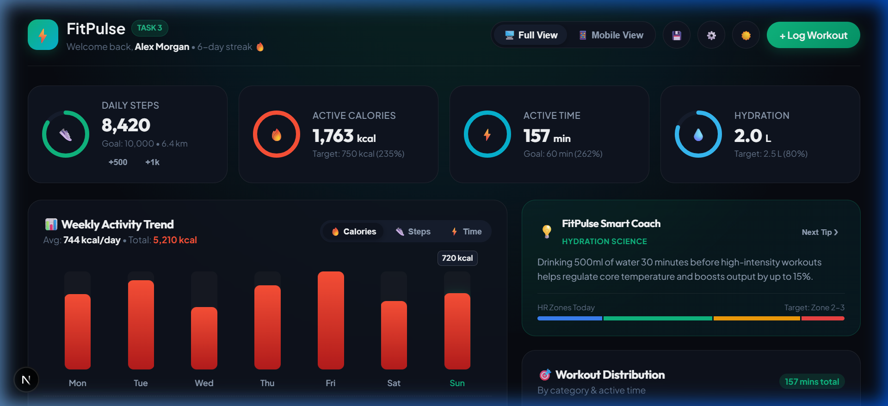
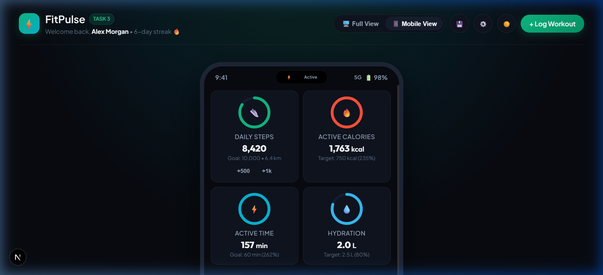
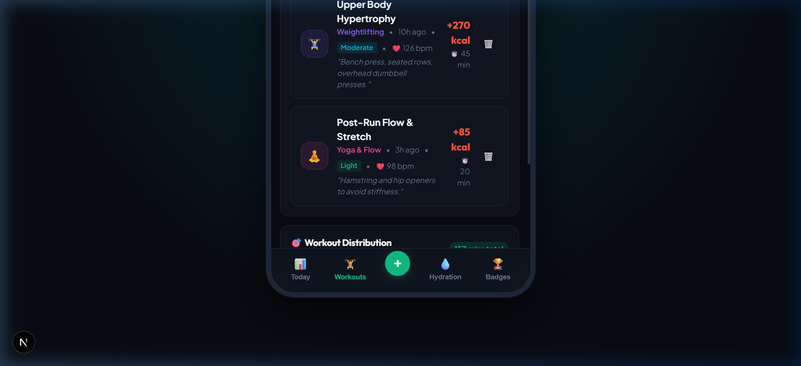
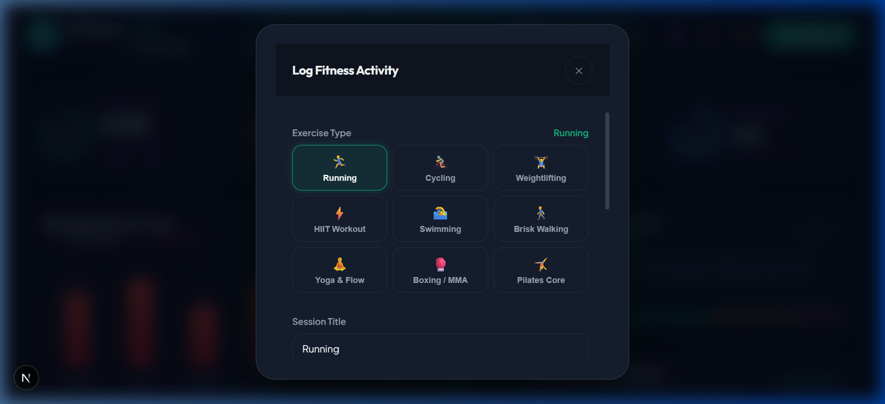

# ⚡ FitPulse — Smart Fitness & Activity Tracker
**CodeAlpha App Development Internship — Task 3**

[](https://nextjs.org/)
[](https://react.dev/)
[](https://www.typescriptlang.org/)
[]()
[](https://www.codealpha.tech/)

A clean, modern, and professional cross-platform **Fitness & Activity Tracker** built for the **CodeAlpha App Development Internship**. Designed to deliver an executive experience on both **Desktop Web Application** and **Native Mobile Application (PWA / Smartphone Simulation)**.

---

## 📱 App Previews & Visual Showcase

### 1. Executive Desktop Web Application


### 2. Native Mobile Application View (iPhone Simulation & Mobile PWA)
| Mobile Today Dashboard | Mobile Workouts Log & Filters |
| :---: | :---: |
|  |  |

### 3. Manual Workout Logger (Auto-Calorie MET Calculator)


---

## 🌟 Key Features

### 1. Daily Fitness Activity Tracking
- **Step Tracking**: Real-time step counter with animated SVG circular progress rings, distance calculation (km), and quick-add actions (+500, +1,000 steps).
- **Active Calories Burned**: Live calculation of total calories burned combining metabolic daily movement and logged workouts.
- **Active Time**: Monitored against daily targets with live percentage completion rings.
- **Interactive Hydration Logger**: Visual glass tracking (+250ml per cup, bottle quick-adds, daily goal tracking).

### 2. Manual Fitness Logging Modal
- **9 Workout Categories**: Running, Cycling, Weightlifting, HIIT, Swimming, Walking, Yoga & Flow, Boxing/MMA, Pilates.
- **MET-Based Automatic Calorie Estimation**: Automatically calculates calories burned based on exercise type, intensity level (Light, Moderate, High, Vigorous), duration, and user body weight.
- **Custom Overrides**: Allows manual adjustments for calories, optional distance (km), and average heart rate (bpm).
- **Celebratory Feedback**: Confetti animations on saving completed workout sessions.

### 3. Interactive Progress Dashboard & Charts
- **Weekly Activity Chart**: Interactive Mon–Sun bar chart with day selection, toggleable metrics (Calories, Steps, Active Minutes), and daily average insights.
- **Filterable Workout Feed**: Search workouts by keyword or filter by category (Cardio, Strength, Flexibility, Sports).
- **Gamification & Trophies**: Streak tracker 🔥, Level 2 Athlete badges, and animated milestone progress bars.

### 4. Dual Experience: Professional Web & Native Mobile App
- **Desktop Dashboard**: Expansive, multi-column analytics layout with glassmorphic cards and ambient lighting.
- **Mobile Smartphone View**: Authentic smartphone frame with Dynamic Island, native status bar, and fixed bottom navigation bar (Today, Workouts, Quick Log, Hydration, Badges).
- **Responsive Mobile Layout**: On real mobile devices, seamlessly adapts to a full-screen mobile app experience.
- **Dark & Light Themes**: Obsidian dark mode with neon accents and clean daylight mode.

### 5. Persistent Local Storage & Backup
- **Automatic Persistence**: All workouts, customized goals, and daily records are automatically saved in browser `localStorage`.
- **JSON Export / Import**: Download your full activity history as a JSON backup or restore past data anytime.
- **Pre-Loaded Seed Data**: Comes with realistic sample workout sessions and week-long activity graphs ready out of the box.

---

## 📝 CodeAlpha Task 3 Requirements Checklist

| Requirement | Status | Implementation Details |
| :--- | :---: | :--- |
| **Track daily fitness activities** | ✅ Completed | Steps, calories burned, active minutes, and water intake with live progress rings |
| **Add / log fitness data manually** | ✅ Completed | Log modal with 9 activities, duration, intensity, optional distance & HR |
| **Dashboard / summary screen** | ✅ Completed | Interactive weekly bar chart with metric selector and daily averages |
| **Simple, clean, user-friendly UI** | ✅ Completed | Clean typography, dark/light themes, smooth micro-animations |
| **Local storage data persistence** | ✅ Completed | Browser `localStorage` with JSON export & import backup support |
| **Web & Mobile Support** | ✅ Completed | Desktop dashboard + simulated smartphone view + 100% responsive mobile layout |

---

## 🚀 Getting Started

### Prerequisites
- Node.js (v18.0.0 or higher)
- npm or yarn

### Installation
1. Clone or navigate to the project directory:
   ```bash
   cd CodeAlpha_ProjectNametask3
   ```

2. Install dependencies:
   ```bash
   npm install
   ```

3. Start the local development server:
   ```bash
   npm run dev
   ```

4. Open your browser and navigate to:
   ```
   http://localhost:3000
   ```

---

## 🛠️ Tech Stack & Architecture

- **Framework**: Next.js 15 (App Router)
- **Language**: TypeScript (Strict mode)
- **Styling**: Modern Vanilla CSS (Design Tokens, Glassmorphism, CSS Variables, Responsive Media Queries)
- **State Management**: React 19 Hooks (`useState`, `useEffect`, `useRef`)
- **Animation**: Canvas Confetti & CSS3 Transitions
- **Icons & Glyphs**: Inline SVGs & UTF-8 Fitness Glyphs
- **Data Persistence**: HTML5 `localStorage` API + JSON Export / Import

---

## 📂 Project Structure

```
CodeAlpha_ProjectNametask3/
├── app/
│   ├── globals.css          # Design system, glassmorphism, responsive rules & mobile phone simulation
│   ├── layout.tsx           # Root layout, PWA meta tags, font imports
│   └── page.tsx             # Main dashboard controller with Desktop & Mobile tab switcher
├── components/
│   ├── Achievements.tsx     # Milestone badges, trophies, and unlock progress
│   ├── ActivityBreakdown.tsx# Category distribution by cardio, strength, flexibility, sports
│   ├── CircularProgress.tsx # Animated circular SVG progress rings
│   ├── DataManagementModal.tsx# JSON Backup, Export, Import, Demo Reset
│   ├── Header.tsx           # Brand header, streak counter, theme and view switcher
│   ├── LogWorkoutModal.tsx  # Manual workout logging with auto MET calorie formula
│   ├── MotivationCard.tsx   # FitPulse smart coach health & recovery science tips
│   ├── QuickStatsModal.tsx  # Athlete profile, weight, BMI calculator, daily targets
│   ├── StatsOverview.tsx    # 4 circular progress metric cards with quick step actions
│   ├── Toast.tsx            # Floating tactile notifications
│   ├── WaterTracker.tsx     # Interactive water cups and hydration manager
│   ├── WeeklyChart.tsx      # Interactive Mon-Sun weekly bar chart
│   └── WorkoutList.tsx      # Filterable & searchable workout history feed
├── lib/
│   └── storage.ts           # LocalStorage engine, initial seed data, MET calorie calculations
├── public/
│   ├── icon.svg             # Vector app icon
│   └── manifest.json        # PWA Web App manifest
├── screenshots/             # Visual demo screenshots for LinkedIn & GitHub presentation
│   ├── desktop-dashboard.png
│   ├── log-workout-modal.png
│   ├── mobile-app-dashboard.png
│   └── mobile-workouts.png
├── types/
│   └── fitness.ts           # TypeScript type definitions for workouts, metrics, profile
├── package.json
├── tsconfig.json
└── README.md
```

---

## 🎥 Submission Instructions for Interns

1. **GitHub Repository**:
   - Push source code to a GitHub repository named `CodeAlpha_ProjectNametask3`.
2. **LinkedIn Video Demo**:
   - Record a 1-2 minute walkthrough showing:
     - Desktop dashboard & live ring animations.
     - Switching between Desktop View and Mobile View.
     - Mobile bottom navigation tabs (Today, Workouts, Hydration, Badges).
     - Manually logging a workout with confetti feedback.
     - Toggling Light / Dark theme.
     - Tag `@CodeAlpha` with your GitHub repository link.
3. **Submission Form**:
   - Submit your GitHub repository URL and LinkedIn post via the CodeAlpha submission form.
